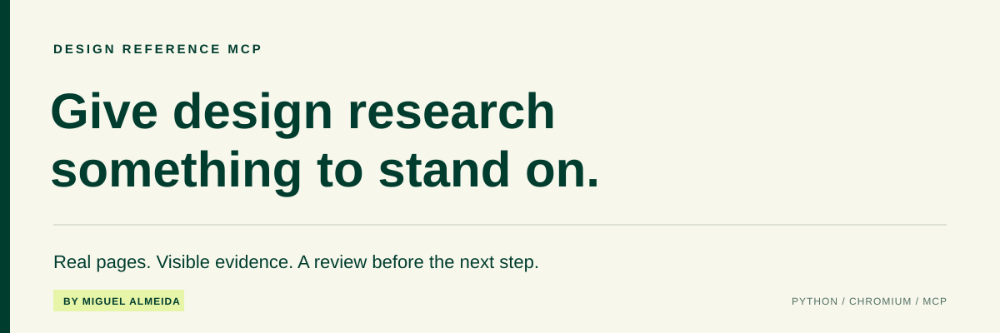
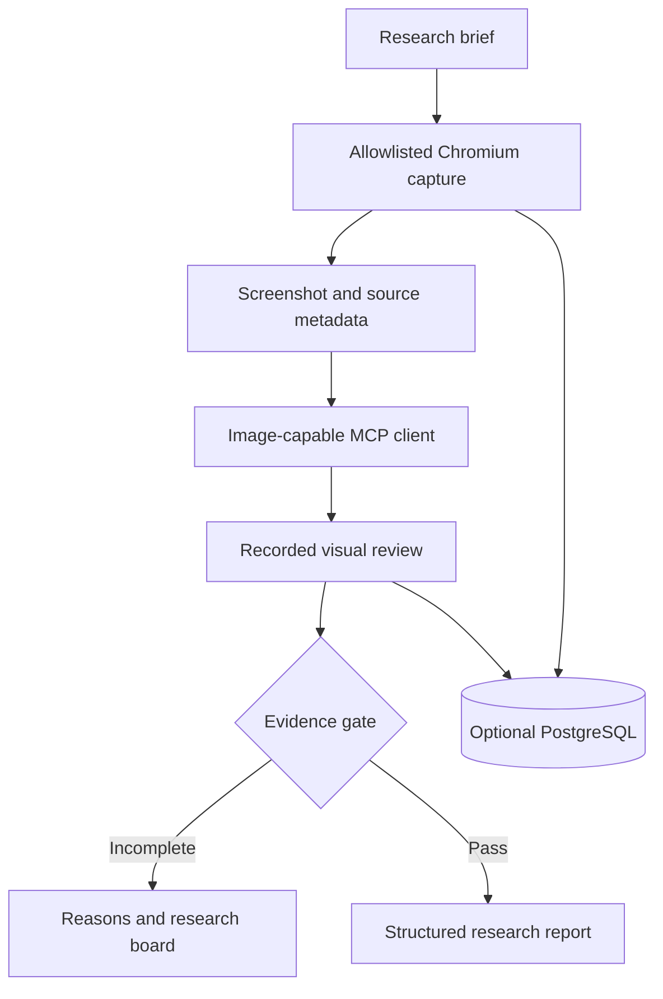

<p align="center"></p>

<p align="center">
  <a href="https://github.com/miguelalmeida0/design-reference-mcp/actions/workflows/tests.yml"></a>
  
  
  
</p>

<p align="center"><a href="#quick-start">Run locally</a> · <a href="docs/architecture.md">Architecture</a> · <a href="docs/tools.md">Tool reference</a> · <a href="docs/deployment.md">Deploy</a> · <a href="docs/limitations.md">Known limits</a></p>

## Research you can inspect

An agent can produce a convincing design rationale without opening a single reference. This project makes the evidence visible: a constrained Chromium browser captures public pages, the MCP client receives actual images, and a review gate checks the recorded research before allowing the workflow to move on.

Built by [Miguel Almeida](https://miguelalmeida.is-a.dev/) while developing an AI-assisted design research workflow. The repository contains the server, a Codex client example, and automated checks. It is self-hosted; no shared public API or API key is provided.

> **A screenshot being delivered is not proof that an agent understood it.** The server enforces a sequence and validates evidence records. Visual judgment remains the responsibility of the reviewer.

## What it does

| Capability | Implementation |
| --- | --- |
| Capture real pages | Playwright + Chromium, with 33 curated seed URLs and a fixed host allowlist |
| Return visual evidence | Screenshots delivered as MCP image content, with source URL and capture metadata |
| Require a review trail | Image retrieval precedes observations, product reasoning, and transferable mechanisms |
| Show the work | A read-only research board displays captures and review status |
| Resume interrupted jobs | Optional PostgreSQL checkpoints store the queue, screenshots, and reviews |
| Bound resource usage | One active research job, per-page Chromium processes, and a cgroup memory guard |

## Quick start

Requires **Python 3.12+**. Commands below use a POSIX shell. On Linux, install Chromium system dependencies with `python -m playwright install --with-deps chromium` if needed.

```bash
git clone https://github.com/miguelalmeida0/design-reference-mcp.git
cd design-reference-mcp
python3 -m venv .venv
source .venv/bin/activate
python -m pip install -r requirements-dev.txt
python -m playwright install chromium

export MCP_API_KEY="$(python -c 'import secrets; print(secrets.token_urlsafe(32))')"
export REFERENCE_BROWSER_TOKEN="$MCP_API_KEY"
export SERVICE_PUBLIC_ORIGIN="http://127.0.0.1:8000"
python -m uvicorn app.main:app --app-dir server --host 127.0.0.1 --port 8000
```

Local development uses temporary files and in-memory jobs when `DATABASE_URL` is unset. Restarting loses that state. For durable storage and HTTPS deployment, follow the [deployment guide](docs/deployment.md).

Connect an image-capable MCP client to **`http://127.0.0.1:8000/mcp`**, with an `Authorization: Bearer <your token>` header. Keep the token in the client's secret configuration. `.env.example` documents the settings; it is not loaded automatically.

### Try the Codex workflow

With the server running, use another terminal and supply the **same token** through your shell's secret mechanism:

```bash
export REFERENCE_BROWSER_ORIGIN="http://127.0.0.1:8000"
# Set REFERENCE_BROWSER_TOKEN to the same raw value as the server's MCP_API_KEY.
# If omitted, the scripts prompt for it without displaying or saving it.
bash examples/codex/check-connection.sh
bash examples/codex/test-research.sh
```

The first command checks health, authentication, tool discovery, and source discovery. The second starts a 28-reference research workflow using the installed Codex CLI. It may incur your normal model usage costs. See the [client guide](examples/codex/README.md) for its bounded tool approvals and sandbox settings.

## How evidence moves through the system



The agent decides what to learn from each reference. The server owns capture, persistence, tool contracts, and validation. [Read the architecture and tradeoffs →](docs/architecture.md)

### The gate

Finalization requires a completed job with **25–30 reviewed captures**, at least **16 project-classified references**, **five distinct source IDs**, unique URLs and screenshot hashes, substantive review fields, and a research age under **12 hours**. Motion-required runs also need **five reviews backed by a positive motion probe**.

These are structural checks, not a measure of design quality. Source IDs are not normalized publisher identities; project classification and motion detection are heuristics. [See the exact limits →](docs/limitations.md)

## Eight focused tools

| Tool | Purpose |
| --- | --- |
| `list_reference_sources` | Read the curated source catalog |
| `start_reference_research` | Start a bounded capture job |
| `get_research_status` | Inspect progress and failed attempts |
| `inspect_reference` | Receive the actual screenshot image |
| `record_visual_review` | Save an observation, rationale, and transferable idea |
| `finalize_reference_research` | Check the evidence gate |
| `get_research_board` | Get the read-only board link |
| `get_research_report` | Read the report and blocking reasons |

[Request examples and response behavior →](docs/tools.md)

## Find your way around

| Path | Responsibility |
| --- | --- |
| [`server/app/`](server/app/) | MCP API, browser capture, review validation, board, and storage |
| [`server/tests/`](server/tests/) | API contracts, evidence gates, recovery, and browser smoke test |
| [`examples/codex/`](examples/codex/) | Client configuration, launch scripts, prompts, and client tests |
| [`docs/`](docs/) | Architecture, protocol, setup, limitations, and security model |
| [`.github/workflows/tests.yml`](.github/workflows/tests.yml) | Automated server/client checks and Chromium rendering smoke test |

## Test it

From the repository root, with the virtual environment active:

```bash
python -m pytest -q
PYTHONPATH=server python server/tests/chromium-smoke-test.py
```

The unit/contract suite uses synthetic fixtures and mocked persistence. The Chromium smoke test renders a local HTML fixture and observes a CSS transition. Neither proves a successful live 28-reference research run or a real PostgreSQL restart. [Validation scope →](docs/validation.md)

## Project status

**Early-stage engineering project.** The code includes authenticated MCP tools, real browser capture, a review board, durable-storage support, and restart handling. Live sites can block automation or exceed available memory, and a research run may finish below the gate's minimum. The workflow must report that outcome rather than invent evidence.

Next priorities: a reproducible live research receipt, real PostgreSQL integration coverage, stronger semantic review checks, and better motion evidence. Current tradeoffs and security boundaries are documented in [Known limits](docs/limitations.md) and [Security](SECURITY.md).

---

[Portfolio](https://miguelalmeida.is-a.dev/) · [LinkedIn](https://www.linkedin.com/in/miguelalmeida1/) · [Contributing](CONTRIBUTING.md)

Source is published for inspection. No open-source license is granted in this repository; third-party dependencies retain their own licenses.
